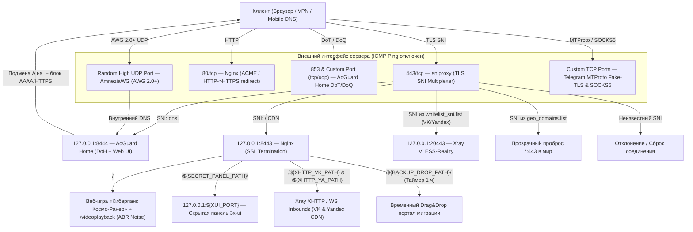

# Архитектура проекта «Server-Combain»

Данный документ описывает сетевую топологию, схему портов, доменную структуру, логику маршрутизации трафика и инварианты безопасности комплекса **Server-Combain** для Ubuntu 24.04 LTS.

---

## 1. Ключевые принципы и отличия от legacy-схемы

1. **Минимум следов в Certificate Transparency (`crt.sh`):**
   - Используется минимальный набор доменов: основной домен `<BASE_DOMAIN>` (и опционально `dns.<BASE_DOMAIN>`) либо единый Wildcard-сертификат `*.<BASE_DOMAIN>`.
   - Внешние поддомены не плодятся без необходимости — админка `3x-ui`, эндпоинты CDN (`XHTTP`/`WS`) и временный портал миграции прячутся по секретным путям за Nginx на основном домене.
2. **Отсутствие хардкода версий:**
   - Все компоненты (`AdGuard Home`, `3x-ui` / `Xray-core`, `AmneziaWG 2.0+`, `mtg`) динамически запрашивают последние стабильные релизы через GitHub API / официальные репозитории во время развертывания и обновления.
3. **Замена тяжелого Nginx Proxy Manager на авто-конфигурируемый Nginx:**
   - Легковесный Nginx в Docker (или на хосте) управляется шаблонами и скриптами без ручной настройки через GUI.
4. **Единый мультиплексор на `443/tcp` (`sniproxy`):**
   - Порт `0.0.0.0:443` принадлежит исключительно `sniproxy`, который маршрутизирует TLS-сессии по заголовку `SNI` без расшифровки чужого трафика.

---

## 2. Схема маршрутизации трафика

---

## 3. Карта портов и сервисов

| Порт / Протокол | Сервис | Слушающий адрес | Доступность снаружи | Назначение |
| :--- | :--- | :--- | :--- | :--- |
| **`443/tcp`** | `sniproxy` | `0.0.0.0:443` | **Открыт** | Главный TLS-мультиплексор по SNI |
| **`80/tcp`** | `nginx` | `0.0.0.0:80` | **Открыт** | Certbot HTTP-01 challenge и редирект на HTTPS |
| **`8443/tcp`** | `nginx` | `127.0.0.1:8443` | Закрыт (`localhost`) | Сайт-заглушка, генератор шума, скрытый прокси 3x-ui, XHTTP/WS, Drag&Drop |
| **`8444/tcp`** | `AdGuardHome` | `127.0.0.1:8444` | Закрыт (`localhost`) | DoH (`/dns-query`) и защищенная панель AdGuard Home |
| **`20443/tcp`** | `xray` (`3x-ui`) | `127.0.0.1:20443` | Закрыт (`localhost`) | Инбаунд **VLESS-Reality** (SNI маскировка под домены белых списков) |
| **`853/tcp, udp`** + **`<CUSTOM_DOT_PORT>`** | `AdGuardHome` | `0.0.0.0` | **Открыт** | DNS-over-TLS (Android Private DNS) и DNS-over-QUIC + резервный нестандартный порт |
| **`53/tcp, udp`** | `AdGuardHome` | `127.0.0.1`, подсеть AWG | **Закрыт снаружи (`iptables`)** | Защита от DNS Amplification, доступен только локально и клиентам AmneziaWG |
| **`3000/tcp`** | `AdGuardHome` | `127.0.0.1:3000` | **Закрыт снаружи (`iptables`)** | Резервный HTTP-порт первичной настройки |
| **`<AWG_PORT>/udp`** | `AmneziaWG (AWG 2.0+)` | `0.0.0.0:<AWG_PORT>` | **Открыт** | Туннель с обфускацией `Jc/Jmin/Jmax`, `S1-S4`, `H1-H4`, `I1-I5` (CPS) |
| **`<MTPROTO_PORT>/tcp`** | `mtg` (`nineseconds/mtg:2`) | `0.0.0.0:<MTPROTO_PORT>` | **Открыт** | Telegram MTProto Fake-TLS прокси (маскировка под белый список) |
| **`<SOCKS5_PORT>/tcp`** | `tg-socks5` | `0.0.0.0:<SOCKS5_PORT>` | **Открыт** | Telegram SOCKS5 прокси с авторизацией (для звонков и медиа) |
| **`<BACKUP_DROP_PORT>/tcp`** | `backup_drop_server.py` | `127.0.0.1:<port>` | Закрыт (`localhost`) | Временный сервис (запускается ровно на 1 час) для передачи архивов миграции |
| **ICMP Echo** | Ядро Linux (`sysctl`) | — | **Заблокирован** | `net.ipv4.icmp_echo_ignore_all = 1` (сервер не отвечает на ping) |

---

## 4. Логика компонентов

### 4.1. Связка AdGuard Home + SNI Proxy (Обход геоблокировок без VPN)
1. Клиент настраивает DoH (`https://dns.<BASE_DOMAIN>/dns-query` или единый домен) либо DoT/DoQ (или подключается к AmneziaWG, который автоматически направляет DNS в AdGuard Home).
2. Для обычных сайтов возвращается реальный IP — трафик идет напрямую.
3. Для доменов из `config/presets/geo_domains.list`:
   - AdGuard Home добавляет правило `$dnsrewrite=NOERROR;A;<SERVER_IP>` в `user_rules`.
   - AdGuard Home блокирует типы `$dnstype=AAAA` и `$dnstype=HTTPS` (SVCB/HTTPS Type 65), предотвращая обход подмены по IPv6 или через `ipv4hint`/`ipv6hint`.
4. Запрос клиента приходит на `<SERVER_IP>:443`. `sniproxy` проверяет `SNI` по белому списку доменов и прозрачно проксирует TLS-поток к целевому зарубежному ресурсу с IP сервера. Неизвестные домены отклоняются.

### 4.2. Маскировка под реальный сервис («Иголка в стоге сена»)
- На корневом пути `https://<BASE_DOMAIN>/` работает интерактивная HTML5/Canvas веб-игра **«Киберпанк Космо-Ранер»**.
- Встроенный в игру/фон режим **«Live 4K Stream / Космо-радио»** через Web Worker / Fetch выполняет запросы к эндпоинту `/videoplayback` (проксируется/генерируется Nginx), получая псевдо-видеопотоки переменного размера (256 КБ – 2 МБ) с паузами, характерными для ABR-профиля (Adaptive Bitrate) YouTube/HLS.
- Опционально на самом сервере может быть включен фоновый генератор правдоподобного медиа-шума для размытия статистического профиля трафика на ТСПУ.

### 4.3. Пробитие белых списков (Xray + 3x-ui + VK/Yandex CDN)
Реализуются два независимых вектора обхода:
1. **VLESS-Reality (`127.0.0.1:20443` за `sniproxy`)**: трафик притворяется TLS-рукопожатием к доверенным ресурсам из `config/presets/whitelist_sni.list` (ресурсы VK, Яндекс и др.).
2. **Реальный проброс через VK Cloud CDN и Yandex Cloud CDN (`XHTTP` / `WebSocket`)**: CDN-провайдер выступает фронтом (клиент стучится на IP самого VK/Яндекс CDN, находящиеся в белых списках операторов), а CDN проксирует запросы на скрытые пути `/<XHTTP_VK_PATH>` и `/<XHTTP_YA_PATH>` нашего сервера.

### 4.4. AmneziaWG (AWG 2.0+ с обратной совместимостью)
- Использует нестандартный случайный высокий UDP-порт.
- Настраивается актуальный профиль параметров:
  - Junk-пакеты перед рукопожатием (`Jc`, `Jmin`, `Jmax`).
  - Рандомный паддинг заголовков (`S1`, `S2`, `S3`, `S4`).
  - Динамические диапазоны / кастомные ID заголовков (`H1`, `H2`, `H3`, `H4`).
  - Цепочка сигнатур имитации легитимных протоколов (`I1`–`I5` CPS).
- Весь DNS-трафик клиентов внутри туннеля направляется в локальный AdGuard Home (без утечек DNS наружу).

### 4.5. Переезд при блокировке IP и резервное копирование
- При блокировке IP провайдером/РКН поддерживаются 3 сценария:
  1. **Быстрая смена IP на текущем сервере:** скрипт определяет новый `SERVER_IP`, обновляет `user_rules` в `AdGuardHome.yaml` (при остановленном сервисе), обновляет `state.env`, перегенерирует клиентские конфиги/ссылки (Xray, AWG, TG Proxy) и подсказывает новые A-записи DNS.
  2. **Бэкап и миграция на новый VPS:** упаковывает `state.env`, сертификаты, `AdGuardHome.yaml`, `x-ui.db`, ключи `AmneziaWG`, кастомные списки доменов и настройки `mtg`/`socks5` в зашифрованный/защищенный архив.
  3. **Временный Drag&Drop портал (1 час):** позволяет скачать архив или перетащить архив со старого сервера в браузер прямо на новый VPS по одноразовому токену, после чего сервер автоматически отключается по таймеру.

---

## 5. Строгие инварианты безопасности

1. **Порт `443/tcp` принадлежит только `sniproxy`:** ни Nginx, ни Xray, ни AdGuard Home не должны биндиться на `0.0.0.0:443`.
2. **Никакого глобального `.* *:443` в `sniproxy.conf`:** в конфиге разрешены только домены из белого списка (`geo_domains.list`, домены сервера и `whitelist_sni.list`), чтобы сервер не стал открытым прокси для ботов.
3. **Никакого `iptables -F` и `ufw enable` поверх работающих контейнеров:** фаервол управляется исключительно точечными идемпотентными правилами в `scripts/lib/firewall.sh`, не ломающими цепочки Docker и маршрутизацию AmneziaWG.
4. **Безопасное редактирование `AdGuardHome.yaml`:** перед любым изменением конфига сервис AdGuard Home обязан быть остановлен (`AdGuardHome -s stop`), иначе при перезапуске он перезапишет файл состоянием из оперативной памяти.
5. **Закрытый порт `53` и `3000`:** порт `53` открыт только для `127.0.0.0/8` и внутренней подсети AmneziaWG.
