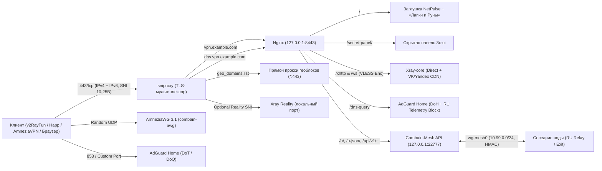

<div align="center">

# 🛠️ Server-Combain

**Автономный self-hosted комбайн для приватного доступа, Smart DNS, маскировки трафика и P2P-кластера**

[](https://ubuntu.com/)
[](https://github.com/XTLS/Xray-core)
[](https://amnezia.org/)
[](docs/mesh_cluster_guide.md)
[](CONTRIBUTING.md)

*Один интерактивный CLI-комбайн (`comb` / `combain`) для развёртывания защищённого сервера за 5 минут, удобного доступа для семьи и друзей и мгновенного переезда при смене IP.*

[⚡ Быстрый старт](#-быстрый-старт-1-команда) • [✨ Возможности](#-что-умеет-server-combain) • [🛡️ Анти-DPI 2026](#️-анти-dpi-и-маскировка-2026) • [🧭 Команды CLI](#-команды-cli-и-меню-110) • [📚 Документация](#-документация)

</div>

---

Добро пожаловать в **Server-Combain**! Этот проект создан для тех, кто хочет поднять собственную надёжную инфраструктуру на чистой **Ubuntu 24.04 LTS** без ручной возни с десятками конфигов. Он одинаково дружелюбен к новичкам (пошаговый мастер, автопроверка DNS, QR-коды для телефонов) и гибок для опытных self-hoster'ов (443-only мультиплексирование, постквантовое шифрование VLESS, Dual-Stack IPv6, CDN-транспорт и децентрализованный P2P-кластер).

---

## ✨ Что умеет Server-Combain

| Компонент | Что делает из коробки |
| :--- | :--- |
| **🌐 Smart DNS + SNI Proxy** | **AdGuard Home** (DoH / DoT / DoQ на `853` + случайный порт) и **sniproxy** на `443/tcp` (IPv4 + Dual-Stack IPv6) со строгим белым списком доменов (`OpenAI`, `Gemini`, `Claude`, `Copilot`, `Spotify` и др.) без полного VPN. |
| **🚀 Xray + 3x-ui + CDN** | Скрытая панель **3x-ui** за Nginx (без лишних открытых портов), **VLESS Encryption (ML-KEM-768+X25519)**, **VLESS-Reality (Self-Steal)**, прямой **XHTTP / WebSocket** и профили для обхода белых списков через **VK Cloud CDN** и **Yandex Cloud CDN**. |
| **🛡️ AmneziaWG 3.1** | Официальный Docker-контейнер `amneziavpn/amneziawg-go:latest` на случайном высоком UDP-порту с обфускацией 3.1 (`HeaderProtectionKey`, `S1–S4`, `H1–H4`, `I1`), локальным AdGuard DNS (`10.8.1.1`), экспортом `.conf`, `vpn://` и QR-кодов. |
| **🎭 Сайт-заглушка + Шум** | Легковесный **Nginx** с реалистичной заглушкой **NetPulse SpeedTest + браузерный рогалик «Лапки и Руны»** (включая пак `.webm` видео-котиков и генератор медиа/облачного трафика `/videoplayback`, `/cloud-sync`). |
| **✈️ Telegram Proxy** | **MTProto Fake-TLS** (`mtg:2`) и **SOCKS5** с авторизацией на случайных портах. Ссылки `tg://` и `t.me/` автоматически обновляются при смене IP. |
| **🕸️ Combain-Mesh (P2P)** | Децентрализованный кластер из нескольких VPS (RU Relay + 2–3 зарубежных Exit-ноды) поверх WireGuard `wg-mesh0` (`10.99.0.0/24`), HMAC-подписанная SQLite LWW-синхронизация, инвайт в 1 строку и персональные подписки с лимитом устройств и сроком действия. |
| **♻️ Переезд и бэкап** | Мгновенная смена IP (`comb change-ip`), шифрованные архивы (AES-256-CBC), прямой перенос по SSH/SCP и **1-часовой Drag&Drop веб-портал** для восстановления на чистом VPS. |

---

## 🗺️ Архитектура (упрощённая схема)

Весь внешний HTTPS-трафик входит строго через порт **`443/tcp`** (IPv4 + IPv6 `[SERVER_IPV6]:443`). `sniproxy` по заголовку TLS SNI разделяет потоки без раскрытия служебных портов:



> Подробные схемы маршрутизации, таблица всех портов и каскадирование RU Relay → Exit разобраны в [docs/architecture.md](docs/architecture.md).

---

## ⚡ Быстрый старт (1 команда)

> Требования: чистый VPS на **Ubuntu 24.04 LTS**, доступ от `root` и свой домен (например, `vpn.example.com` + `dns.vpn.example.com`).

### Вариант 1 — Через `curl` (рекомендуемый)

```bash
curl -fsSL https://raw.githubusercontent.com/Zhaborovs/serverDNS/main/install.sh | bash && comb
```

### Вариант 2 — Через `git clone`

```bash
apt-get update -y && apt-get install -y git && rm -rf /opt/server-combain && git clone https://github.com/Zhaborovs/serverDNS.git /opt/server-combain && bash /opt/server-combain/install.sh && comb
```

Установщик автоматически поставит базовые зависимости и Docker Engine, развернёт проект в `/opt/server-combain` и зарегистрирует глобальные команды **`comb`** и **`combain`**. После запуска выберите пункт **`1`** — интерактивный мастер сам проверит DNS-записи (`dig @1.1.1.1` / `@8.8.8.8`), выпустит SSL-сертификаты и настроит весь стек.

---

## 🛡️ Анти-DPI и маскировка (2026)

Server-Combain спроектирован с учётом современных методов анализа трафика и белых списков:

1. **443-Only Stealth + реалистичная заглушка NetPulse / «Лапки и Руны»**
   - По умолчанию внешние порты VLESS-TLS и Reality отключены (`0`), ICMP `ping` заблокирован, а снаружи виден обычный веб-сервер на `443/tcp`.
   - При открытии `https://vpn.example.com/` в браузере или активном зондировании сервер отдаёт полноценный **NetPulse SpeedTest** и браузерный рогалик **«Лапки и Руны»** с медиа-контентом, а скрытая панель `3x-ui` и пути XHTTP/WS спрятаны за случайными токенами.
2. **Постквантовый VLESS Encryption (`ML-KEM-768 + X25519`)**
   - Встроенное нативное шифрование Xray 26.x (`mlkem768x25519plus.random.0rtt`) с рандомным паддингом первых пакетов защищает туннель поверх XHTTP/WS и затрудняет сигнатурный анализ даже при прохождении через CDN.
3. **Фрагментация SNI 10–25 байт (`finalmask`)**
   - JSON-подписки (`/sub-json/<token>` и `/u-json/<token>`) автоматически включают сырую TCP-сегментацию первого пакета (`packets: "1-1"`, `length: "10-25"`, `delay: "5-10"` мс). Это аккуратно разрезает SNI внутри TLS ClientHello без поломки TLS Record Header — полностью совместимо со `sniproxy` и Nginx.
4. **Dual-Stack IPv6 (`[SERVER_IPV6]:443`) + флаги стран**
   - При наличии глобального IPv6 на сервере `sniproxy` привязывается к конкретному адресу `[2001:db8::1]:443` (без конфликта с `0.0.0.0:443`), а подписки автоматически получают IPv4 + IPv6 маршруты с эмодзи-флагами стран (`🇩🇪`, `🇳🇱`, `🇫🇮`, `🇷🇺` и др.).
5. **2-уровневый Split-Tunneling для RU / MAX / Госуслуг + блокировка SDK-телеметрии**
   - **Уровень 1 (`config/presets/ru_bypass_domains.list`):** зоны `.ru`, `.su`, `.рф`, Госуслуги, мессенджер **MAX** (`max.ru`, `oneme.ru`), банки РФ, СБП, маркетплейсы, VK и Яндекс направляются клиентом Xray напрямую (`direct`), минуя VPN — приложения не видят зарубежный IP.
   - **Уровень 2 (`config/presets/ru_telemetry_block.list`):** домены SDK-телеметрии (`apptracer.ru`, `tracker-api.my.com`, Яндекс AppMetrica) и внешние IP-чекеры (`api.ipify.org`, `ifconfig.me`, `checkip.amazonaws.com`) блокируются **сразу на двух уровнях** — в Xray routing (`block` выше правила `direct`) и в AdGuard Home Smart DNS (`||domain^`) при выключенном VPN, не ломая рабочие API MAX, Госуслуг и банков.
6. **Децентрализованный кластер Combain-Mesh для семьи и друзей**
   - Объединяйте 2–5 серверов в приватную P2P-сеть без центральной точки отказа: автоопределение роли по GeoIP (`ru_relay` / `exit`), подключение новых нод 1-строчным токеном `combain-join://`, персональные подписки с лимитом устройств (HWID) и датой окончания, а также синхронное обновление всего кластера одной командой.

---

## 🧭 Команды CLI и меню (`1`–`10`)

После установки доступны короткая команда **`comb`** и полная **`combain`** (полные синонимы):

| Команда | Назначение |
| :--- | :--- |
| `comb` / `combain` | Открыть главное интерактивное меню (пункты `1`–`10`) |
| `comb install` | Запустить полную установку стека с нуля |
| `comb info` | Открыть подменю сводки настроек, ссылок и паролей (`comb info --all` — вывести всё сразу) |
| `comb qr` | Открыть меню генерации QR-кодов (Подписки Base64/JSON, VLESS, CDN, AWG 3.1, Telegram) |
| `comb mesh` | Открыть меню кластера **Combain-Mesh** и управления пользователями |
| `comb service` | Меню сервиса: статус служб/портов, обновление Docker-образов и стека |
| `comb update` | Обновить текущий сервер (`git pull` + переприменить Nginx, AdGuard, `sniproxy`, 3x-ui, подписки) |
| `comb update --cluster` | Синхронно обновить **весь кластер** Combain-Mesh (текущий сервер + все онлайн-ноды) |
| `comb change-ip` | Мастер быстрой смены IPv4 (когда хостер выдал новый IP, а домен остался прежним) |
| `comb migrate` | Мастер бэкапа и переезда (1-часовой Drag&Drop портал, URL/файл, перенос по SSH/SCP) |

### Обзор пунктов интерактивного меню `comb`

| № | Пункт меню | Что внутри |
| :-: | :--- | :--- |
| **1** | **Полная установка с нуля** | Мастер домена/DNS, системный тюнинг (BBR, запрет `ping`), SSL/Nginx + заглушка, AdGuard Home, `sniproxy`, 3x-ui/Xray, AmneziaWG 3.1, Telegram Proxy. |
| **2** | **Быстрая смена IP** | Автодетект нового IPv4, обновление правил AdGuard Home, Endpoint и `vpn://` в AmneziaWG, перезапуск `sniproxy` и пересборка подписок. |
| **3** | **Переезд / Бэкап** | Создание шифрованного `.tar.gz.enc`, временный Drag&Drop портал (1 час), восстановление по URL/файлу или прямое стягивание со старого VPS по SSH/SCP. |
| **4** | **Управление доменами геоблока** | Применение пресета `geo_domains.list`, синхронное добавление/удаление доменов в AdGuard Home и `sniproxy`, просмотр активного списка. |
| **5** | **Управление VPN и клиентами** | Привязка доменов VK/Yandex CDN, добавление клиентов AmneziaWG 3.1, ротация Telegram Proxy, обновление заглушки/котиков, QR-коды и внешние ноды подписки. |
| **6** | **Сводка настроек и доступов** | Удобное подменю по разделам: Smart DNS (+ команда Windows 11 DoH), Xray/3x-ui (`/sub` и `/sub-json`), AmneziaWG 3.1, Telegram Proxy. |
| **7** | **Пароли и доступы** | Просмотр и безопасная смена логинов/паролей AdGuard Home и скрытой панели `3x-ui`. |
| **8** | **QR-коды подключений** | Мгновенный вывод QR-кодов в терминал для единой подписки, каждого VLESS-профиля, AmneziaWG 3.1 и Telegram Proxy. |
| **9** | **Кластер Combain-Mesh и пользователи** | Инициализация ноды, 1-строчные инвайты, синхронизация пиров, управление пользователями (HWID, сроки, персональные подписки `/u/` и `/u-json/`). |
| **10** | **Сервис и автообновление стека** | Обновление текущего сервера, синхронное обновление всего кластера, обновление Docker-образов и проверка статуса всех служб/портов. |

---

## 📚 Документация

| Документ | Для кого и что внутри |
| :--- | :--- |
| 📱 [docs/quickstart_clients.md](docs/quickstart_clients.md) | **Пошаговая настройка клиентов:** Android (`v2RayTun` + Per-App Bypass для MAX, Госуслуг и банков), iOS (`Happ` / `v2RayTun`), Windows/macOS, AmneziaWG 3.1 и Smart DNS. |
| 🏗️ [docs/architecture.md](docs/architecture.md) | **Архитектура и схемы:** 443/tcp SNI-мультиплексирование, VLESS Encryption, 2-уровневый RU Split-Tunneling, топология Combain-Mesh и полная таблица портов. |
| 🕸️ [docs/mesh_cluster_guide.md](docs/mesh_cluster_guide.md) | **Руководство по Combain-Mesh:** сборка кластера (RU Relay + Exit), 1-строчный `combain-join://`, GeoIP авто-роли, IPv6-каскад, плейбук смены IP (TTL=300) и подписки для семьи. |
| ☁️ [docs/cdn_whitelist_guide.md](docs/cdn_whitelist_guide.md) | **Обход белых списков через CDN:** пошаговое подключение VK Cloud CDN (GET-only XHTTP) и Yandex Cloud CDN (XHTTP/WS). |
| 🩺 [docs/faq_troubleshooting.md](docs/faq_troubleshooting.md) | **FAQ и решение проблем:** диагностика, частые вопросы, восстановление после блокировок и типовые ошибки. |
| 🤝 [CONTRIBUTING.md](CONTRIBUTING.md) | **Участие в разработке:** запуск тестов, стандарты Bash/Python, LF-окончания строк, чеклист PR и правило нулевых секретов. |

---

## ⚖️ Ответственное использование

Server-Combain разрабатывается и распространяется как открытый инструмент системного администрирования для защиты личной приватности, шифрования DNS/трафика в публичных сетях и управления собственной серверной инфраструктурой. Пожалуйста, используйте проект ответственно и в соответствии с законодательством вашей юрисдикции и правилами вашего хостинг-провайдера.
