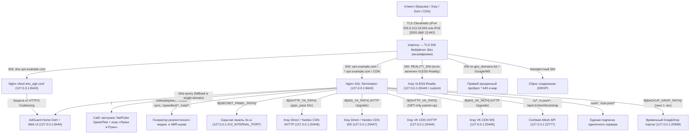
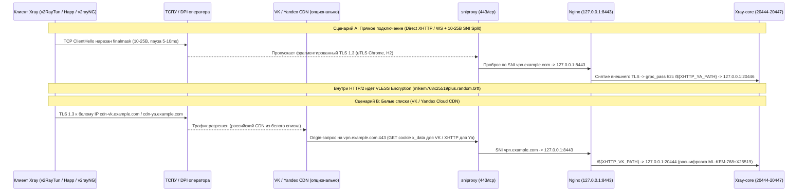
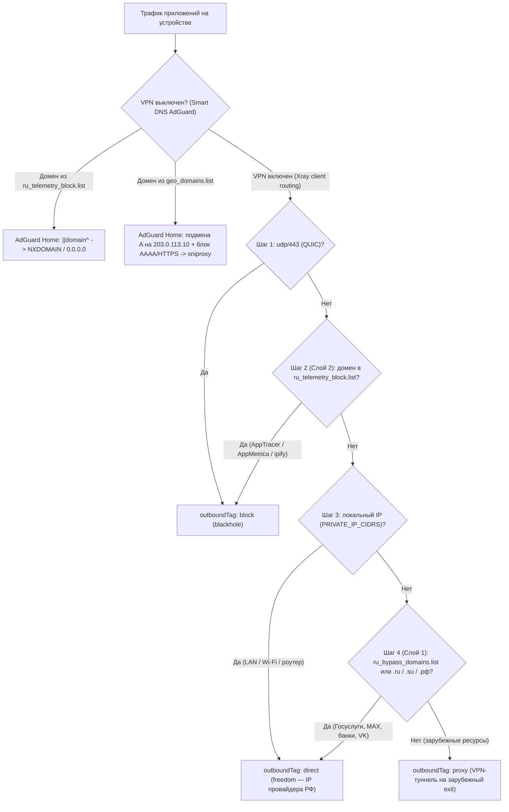
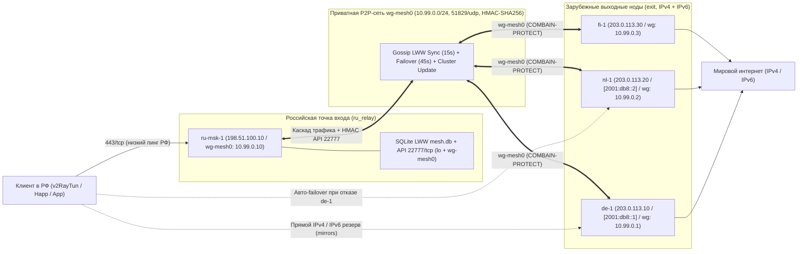

# Архитектура Server-Combain

> Навигация: [Главная (README)](../README.md) · [Быстрый старт для клиентов](quickstart_clients.md) · [Кластер Combain-Mesh](mesh_cluster_guide.md) · [VK / Yandex CDN (белые списки)](cdn_whitelist_guide.md) · [FAQ и диагностика](faq_troubleshooting.md)

Данный документ визуально и пошагово описывает сетевой стек **Server-Combain**: стелс-мультиплексирование порта `443/tcp`, анти-ТСПУ конвейер с постквантовым **VLESS Encryption**, двухуровневый RU-обход с блокировкой телеметрии и децентрализованную P2P-топологию **Combain-Mesh**.

---

## 1. Стелс-стек `443/tcp` и SNI-мультиплексирование

Ключевой принцип безопасности Server-Combain — **минимальная поверхность атаки**. По умолчанию снаружи открыт единый TLS-порт `443/tcp` (а также `80/tcp` для ACME HTTP-01 и опциональные порты DoT/DoQ, AWG, TG Proxy).

### Как работает `sniproxy` на IPv4 и IPv6

- На IPv4 `sniproxy` слушает `0.0.0.0:443`.
- При наличии внешнего IPv6 модуль `04_sniproxy.sh` добавляет слушатель на **конкретный глобальный IPv6-адрес** `[2001:db8::1]:443` (а не wildcard `[::]:443`), чтобы исключить конфликт dual-stack привязки `Address already in use` с `0.0.0.0:443` при `net.ipv6.bindv6only=0`. В `ip6tables` точечно разрешаются `ipv6-icmp` и `443/tcp`.
- Резолвер `sniproxy` использует внешние DNS (`1.1.1.1`, `8.8.8.8`, режим `ipv4_only`), что исключает петлю маршрутизации через локальный AdGuard Home.
- **Строгий инвариант:** глобальное правило `.* *:443` запрещено. Любой неизвестный `SNI` немедленно сбрасывается — сервер не может использоваться как открытый прокси.

### Примечание по VLESS-Reality

- В режиме максимальной маскировки по умолчанию внешние порты `XRAY_DIRECT_TLS_PORT=0` и `XRAY_DIRECT_REALITY_PORT=0` отключены: наружу торчит только `443/tcp` (`sniproxy` -> `Nginx` -> `XHTTP`/`WS`).
- При включении **VLESS-Reality** поддерживаются два сценария:
  1. **Self-Steal Reality** (рекомендуется против троттлинга ТСПУ при всплеске потоков YouTube): `REALITY_SNI=vpn.example.com`, `dest=127.0.0.1:8443` — маскировка под собственный валидный TLS-сайт на том же ASN.
  2. **Внешний белый список (`whitelist_sni.list`)**: `sniproxy` перенаправляет выбранный `REALITY_SNI` на локальный порт Xray Reality.

---

## 2. VLESS Encryption (ML-KEM-768+X25519) + XHTTP/WS + 10–25B SNI Split

Для прохождения глубокой инспекции пакетов (ТСПУ / DPI) и «белых списков» мобильных операторов в Server-Combain объединены три уровня защиты:

1. **TCP-фрагментация первого пакета (10–25B SNI Split):** в клиентские профили вшит `finalmask` (`type: "fragment"`, `packets: "1-1"`, `length: "10-25"`, `delay: "5-10"` мс). Первый TCP-сегмент с TLS `ClientHello` нарезается на куски по 10–25 байт — ТСПУ не может извлечь `SNI` из одного пакета, при этом `sniproxy` и `Nginx` корректно собирают TLS-заголовок без обрывов.
2. **Постквантовый нативный VLESS Encryption (`ML-KEM-768 + X25519`):**
   - Сервер (Xray): `decryption = "mlkem768x25519plus.random.600s.<priv_key>"`.
   - Клиент: `encryption = "mlkem768x25519plus.random.0rtt.<pub_key>"`.
   - Режим `random` добавляет случайный паддинг к первым пакетам, полностью скрывая сигнатуры протокола VLESS даже внутри CDN-туннеля.
3. **Транспорт XHTTP (`stream-one` + XMUX) и WebSocket + CDN-проброс:**
   - **Прямой режим (443/tcp):** `XHTTP` поверх HTTP/2 (`alpn: ["h2"]`, `uTLS chrome`, `xPaddingBytes: "150-900"`, браузерные `User-Agent` / `Accept-Language`) с пулом `xmux` (`maxConcurrency: 4-8`, ротация сокетов `300-600s`). На стороне Nginx используется `grpc_pass` (`h2c`) к `127.0.0.1:20446`.
   - **Обход белых списков через VK Cloud CDN и Yandex Cloud CDN:** клиент подключается к доверенным российским IP-адресам CDN-провайдера, который проксирует запросы на скрытый путь вашего origin-сервера `vpn.example.com:443`. Для **VK Cloud CDN** (где `POST` и `WS` отключены по умолчанию) используется специальный GET-only режим `XHTTP packet-up` с передачей uplink-данных в `Cookie: x_data`.

---

## 3. Двухуровневый RU / MAX / Госуслуги Split-Tunneling и блокировка телеметрии

Российские банковские приложения, **Госуслуги** и мессенджер **MAX** (`max.ru`, `oneme.ru`) активно проверяют сетевое окружение: детектируют зарубежный IP или опрашивают внешние IP-чекеры и SDK-телеметрию. В Server-Combain эта проблема решается **двумя скоординированными слоями** без необходимости хранить файлы `geoip.dat` / `geosite.dat` на клиентах (совместимо с Xray 26.x).

- **Слой 2 — Блокировка телеметрии и IP-проб (`config/presets/ru_telemetry_block.list`):**
  - Включает 15 доменов: VK/MAX SDK (`apptracer.ru`, `sdk-api.apptracer.ru`, `tracker-api.my.com`, `tracker-api.vk-portal.net`, `stats.vk-portal.net`, `vk-analytics.ru`, `top-fwz1.mail.ru`, `rs.mail.ru`), Яндекс AppMetrica (`report.appmetrica.yandex.net`, `startup.mobile.yandex.net`, `appmetrica.yandex.ru`, `mc.yandex.ru`) и IP-чекеры (`api.ipify.org`, `ifconfig.me`, `checkip.amazonaws.com` для модуля `HOST_REACHABILITY`).
  - Работает **в двух местах одновременно**:
    1. В клиентской маршрутизации Xray (`outboundTag: "block"` / `blackhole`) — стоит **ВЫШЕ** правила `direct`, поэтому телеметрия блокируется до ухода в прямой канал.
    2. В **AdGuard Home Smart DNS** (правила `||domain^`) — защищает устройство даже при выключенном VPN.
  - Рабочие API (`api.oneme.ru`, `max.ru`, `gosuslugi.ru`, банки) **не затрагиваются**.
- **Слой 1 — Прямой обход RU и локальных сетей (`config/presets/ru_bypass_domains.list`):**
  - Все домены из пресета (Госуслуги, MAX, VK, Сбер, Т-Банк, ВТБ, Альфа, СБП/НСПК, Ozon, Wildberries, Яндекс, операторы связи и др.), зоны `regexp:.*\.(ru|su|xn--p1ai)$`, а также явные локальные CIDR (`10.0.0.0/8`, `192.168.0.0/16`, `172.16.0.0/12`, `100.64.0.0/10`, `fc00::/7`, `fe80::/10` и др.) направляются напрямую в `outboundTag: "direct"`.
- Дополнительно на клиенте и сервере блокируется `udp/443` (**QUIC**), чтобы браузеры переключались на стабильный TCP/H2 без утечек и деградации на ТСПУ.

---

## 4. Топология кластера Combain-Mesh (P2P)

**Combain-Mesh** объединяет **1 российский ретранслятор (`ru_relay`)** и **2–3 зарубежных выходных сервера (`exit`)** в единую отказоустойчивую P2P-сеть без выделенного мастер-сервера (No Single Point of Failure).

- **Приватный транспорт:** интерфейс WireGuard `wg-mesh0` (`10.99.0.0/24`, `51829/udp`, `PersistentKeepalive = 25`).
- **Синхронизация состояния (SQLite LWW):** каждая нода хранит локальную базу `/etc/server-combain/mesh.db` и каждые **15 секунд** обменивается дельтами (`POST /mesh/sync`) с пирами. Конфликты разрешаются детерминированно по принципу **Last-Write-Wins** (по временной метке `updated_at`). Изменения пользователей и ролей (включая удалённую смену роли `exit <-> ru_relay`) мгновенно синхронизируются на все ноды и применяются в локальной базе `/etc/x-ui/x-ui.db`.
- **Безопасность и изоляция фаервола (`COMBAIN-PROTECT`):**
  - Вся межсерверная передача (`GET /mesh/health`, `POST /mesh/sync`, `POST /mesh/update`) подписывается **HMAC-SHA256** (`X-Mesh-Sig` + `X-Mesh-Timestamp` с защитой от replay-атак ±60 сек).
  - Модуль `10_mesh_cluster.sh` добавляет правила строго в изолированную цепочку `COMBAIN-PROTECT` (не сбрасывая `iptables` и не ломая цепочки Docker): порт `51829/udp` открыт для WireGuard, а порт API `22777/tcp` разрешён **исключительно** на `lo` и `wg-mesh0` (`DROP` на всех остальных интерфейсах).
- **Отказоустойчивость и IPv6-каскад:**
  - Если пир не отвечает более **45 секунд**, он помечается `offline` и автоматически исключается из клиентских подписок (`/u/`, `/u-json/`, `/api/v1/client/bootstrap`) и из цели каскада (`mesh_cascade_target.json`).
  - Ноды с внешним IPv6 автоматически публикуют `public_ipv6` в кластере: клиенты получают резервные `-IPv6` профили, а `ru_relay` пробрасывает входящий клиентский трафик на здоровую `exit`-ноду поверх зашифрованного `wg-mesh0`.

---

## 5. Сводная таблица портов и внутренних привязок

Все адреса и порты ниже соответствуют актуальной конфигурации в `config/default.env.example`, `templates/sniproxy.conf.tpl`, `templates/nginx_site.conf.tpl` и модулях `scripts/modules/`.

| Порт / Протокол | Сервис | Привязка (Bind) | Доступность снаружи | Назначение |
| :--- | :--- | :--- | :--- | :--- |
| **`443/tcp`** | `sniproxy` | `0.0.0.0:443` + `[SERVER_IPV6]:443` | **Открыт** | Единый TLS SNI-мультиплексор (IPv4 + конкретный IPv6 без конфликта `[::]:443`) |
| **`80/tcp`** | `combain-nginx` | `0.0.0.0:80` | **Открыт** | Certbot HTTP-01 (`/.well-known/acme-challenge/`), `/speedtest/sink` и редирект на HTTPS |
| **`8443/tcp`** | `combain-nginx` | `127.0.0.1:8443` | Закрыт (`localhost`) | SSL-терминация, заглушка NetPulse / «Лапки и Руны», прокси к 3x-ui, Xray XHTTP/WS, Mesh API, `dns_agh.conf` |
| **`8444/tcp`** | `AdGuardHome` | `127.0.0.1:8444` | Закрыт (`localhost`) | DoH (`/dns-query`) и защищённый веб-интерфейс AdGuard Home (за Nginx) |
| **`853/tcp, udp`** + **`<AGH_CUSTOM_DOT_PORT>`** | `AdGuardHome` | `0.0.0.0` | **Открыт** | DNS-over-TLS (Android Private DNS) и DNS-over-QUIC + случайный резервный порт (`8850–9850`) |
| **`53/tcp, udp`** | `AdGuardHome` | `127.0.0.1`, подсеть AWG (`10.8.1.0/24`) | **Закрыт (`iptables`)** | Защита от DNS Amplification; доступен только локально и клиентам AmneziaWG |
| **`3000/tcp`** | `AdGuardHome` | `127.0.0.1:3000` | Закрыт (`localhost`) | Резервный внутренний HTTP-порт первичной настройки |
| **`<XUI_INTERNAL_PORT>/tcp`** | `combain-3xui` | `127.0.0.1:<21000–28000>` | Закрыт (`localhost`) | Скрытая веб-панель `3x-ui` (проксируется через `/<SECRET_PANEL_PATH>/`) |
| **`20443/tcp`** *(опц.)* | `xray` (`3x-ui`) | `127.0.0.1:20443` (или `0` = выкл.) | Закрыт / опционально | Инбаунд **VLESS-Reality** (отключён по умолчанию ради режима «только `443/tcp`») |
| **`20444/tcp`** | `xray` (`3x-ui`) | `127.0.0.1:20444` | Закрыт (`localhost`) | Инбаунд **VK-CDN-XHTTP** (`GET-only packet-up`, cookie `x_data`, VLESS Encryption) |
| **`20445/tcp`** | `xray` (`3x-ui`) | `127.0.0.1:20445` | Закрыт (`localhost`) | Инбаунд **VK-CDN-WS** (WebSocket fallback, VLESS Encryption) |
| **`20446/tcp`** | `xray` (`3x-ui`) | `127.0.0.1:20446` | Закрыт (`localhost`) | Инбаунд **Yandex-CDN-XHTTP / Direct XHTTP** (`grpc_pass h2c`, `stream-one`, VLESS Encryption) |
| **`20447/tcp`** | `xray` (`3x-ui`) | `127.0.0.1:20447` | Закрыт (`localhost`) | Инбаунд **Yandex-CDN-WS / Direct WS** (WebSocket fallback, VLESS Encryption) |
| **`20999/tcp`** | `backup_drop_server.py` | `127.0.0.1:20999` | Закрыт (`localhost`) | Временный Drag&Drop портал миграции бэкапов (авто-отключение через 1 час) |
| **`51829/udp`** | `wg-quick@wg-mesh0` | `0.0.0.0:51829` | **Открыт (`COMBAIN-PROTECT`)** | Приватный WireGuard-туннель кластера **Combain-Mesh** (`10.99.0.0/24`) |
| **`22777/tcp`** | `combain-mesh` | `127.0.0.1:22777` + `<MESH_WG_IP>:22777` | **Закрыт (`COMBAIN-PROTECT` DROP снаружи)** | HTTP API кластера: HMAC-синхронизация пиров (`/mesh/*`) и клиентские подписки (`/u/`, `/u-json/`, `/api/v1/client/bootstrap` за Nginx) |
| **`<AWG_PORT>/udp`** | `awg-quick@awg0` | `0.0.0.0:<32000–54000>` | **Открыт** | Туннель **AmneziaWG (AWG 3.1 / 2.0+)** с обфускацией `Jc/Jmin/Jmax`, `S1–S4`, `H1–H4`, `I1–I5` |
| **`<MTPROTO_PORT>/tcp`** | `combain-mtproto` (`mtg:2`) | `0.0.0.0:<18000–20000>` | **Открыт** | Telegram MTProto Fake-TLS прокси |
| **`<SOCKS5_PORT>/tcp`** | `combain-socks5` | `0.0.0.0:<10800–17999>` | **Открыт** | Telegram SOCKS5 прокси с авторизацией (звонки и медиа) |
| **ICMP Echo (IPv4)** | Ядро Linux (`sysctl`) | — | **Заблокирован** | `net.ipv4.icmp_echo_ignore_all = 1` (сервер не отвечает на IPv4 ping; для IPv6 разрешён `ipv6-icmp` по RFC) |

---

> Следующие шаги: [Развернуть кластер Combain-Mesh](mesh_cluster_guide.md) · [Настроить VK / Yandex CDN](cdn_whitelist_guide.md) · [Подключить устройства](quickstart_clients.md) · [Вернуться в README](../README.md)
